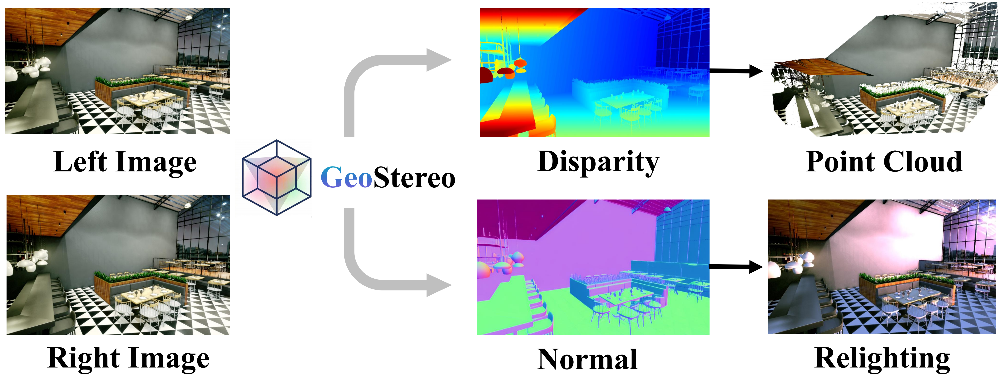
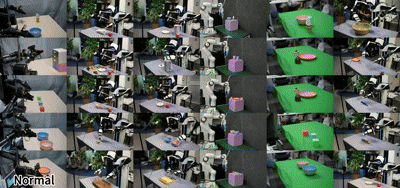
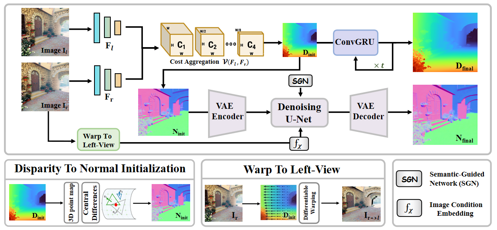

<div align="center">

<h1>GeoStereo: A Unified Stereo Geometry Estimation Framework for Disparity and Surface Normal</h1>

<p>
  Qizhe Wei, Xianda Guo, Shaocong Xu, Hong Li, Runyi Yang, Hao Zhao
</p>


<a href="https://arxiv.org/abs/2607.24024">
  
</a>
<a href="https://qz-wei.github.io/GeoStereo.github.io/">
  
</a>
<a href="https://huggingface.co/qz-wei/GeoStereo">
  
</a>

</div>

---

<p align="center">
  
</p>

<p align="center">
  
</p>

---

## Overview

**GeoStereo** is a unified stereo geometry estimation framework for disparity and surface-normal prediction. Given a rectified stereo pair, GeoStereo first estimates dense binocular correspondence and converts the predicted disparity into an initial surface-normal prior. Meanwhile, the right image is warped into the left camera view to provide explicit stereo appearance and correspondence cues.

These complementary geometric signals are encoded in the latent space and injected into a diffusion UNet through two dedicated conditioning branches:

- a **warped-view ControlNet**, which provides appearance and correspondence information from the right image warped into the left camera view;
- a **normal-prior ControlNet**, which provides a geometry-aware condition derived from stereo disparity.

The diffusion model combines stereo geometry with generative visual priors to predict spatially coherent surface normals while preserving scene structure and object boundaries. The same pipeline also returns the FoundationStereo disparity estimate, providing disparity and surface-normal prediction within one stereo geometry framework.

<p align="center">
  
</p>


## Installation

The environment was tested with:

- Python 3.11
- PyTorch 2.4.1
- CUDA 12.1
- Linux

### 1. Clone the repository

```bash
git clone https://github.com/qz-wei/GeoStereo.git
cd GeoStereo
```

### 2. Create a Conda environment

```bash
conda create -n GeoStereo python=3.11 -y
conda activate GeoStereo
```

### 3. Install dependencies

```bash
python -m pip install --upgrade pip setuptools wheel
pip install -r requirements.txt
```

If `flash-attn` fails to build, install it separately without build isolation:

```bash
pip install flash-attn==2.8.3 --no-build-isolation
```

---

## Pretrained Weights

The pretrained GeoStereo model is available on Hugging Face:

- [qz-wei/GeoStereo](https://huggingface.co/qz-wei/GeoStereo)

Download the complete model repository with the Hugging Face CLI:

```bash
mkdir -p checkpoints/GeoStereo

hf download qz-wei/GeoStereo \
  --local-dir checkpoints/GeoStereo
```

Alternatively, use Git LFS:

```bash
git lfs install

git clone https://huggingface.co/qz-wei/GeoStereo \
  checkpoints/GeoStereo
```

The model directory should follow this structure:

```text
checkpoints/GeoStereo/
├── GeoStereo_config.json
├── unet/
├── controlnet/
├── normal_controlnet/
├── vae/
├── text_encoder/
├── tokenizer/
├── scheduler/
└── foundation_stereo/
    ├── config.json
    └── model.safetensors
```

All components are loaded from the same model directory. No additional FoundationStereo configuration or checkpoint path is required.

---

## Inference

GeoStereo takes one rectified left-right stereo pair and saves two predictions:

```text
normal.png
disparity.png
```

Run inference with:

```bash
python infer.py \
  --model_path checkpoints/GeoStereo \
  --left /path/to/left.png \
  --right /path/to/right.png \
  --save_dir outputs/example
```

Optional runtime arguments include:

```text
--device        Inference device, such as cuda, cuda:0, or cpu
--dtype         Diffusion-model precision: fp32, fp16, or bf16
--seed          Random seed used to initialize the diffusion latent
```


The output directory contains only:

```text
outputs/example/
├── normal.png
└── disparity.png
```

The Python output object exposes:

```python
output.normal
output.disparity
```


---


## Training

GeoStereo supports distributed training with Hugging Face Accelerate.

All model components are initialized from one complete GeoStereo checkpoint through `--restore_ckpt`. The training script does not require a separate base diffusion checkpoint, FoundationStereo YAML file, or FoundationStereo `.pth` checkpoint.

A four-GPU training example is:

```bash
accelerate launch \
  --multi_gpu \
  --num_processes 4 \
  --mixed_precision no \
  --dynamo_backend no \
  train.py \
  --restore_ckpt checkpoints/GeoStereo \
  --output_dir outputs/ckpt \
  --logging_dir outputs/logs \
  --train_batch_size 2 \
  --max_train_steps 40000 \
  --learning_rate 2e-5 \
  --vis_step 50
```

The restored checkpoint must contain:

```text
restore_ckpt/
├── unet/
├── controlnet/
├── normal_controlnet/
├── vae/
├── text_encoder/
├── tokenizer/
├── scheduler/
└── foundation_stereo/
    ├── config.json
    └── model.safetensors
```

During training:

- the UNet, warped-view ControlNet, and normal-prior ControlNet are optimized;
- the VAE and text encoder are frozen;
- FoundationStereo is frozen and runs in FP32;
- FoundationStereo provides disparity and the stereo-derived normal prior;
- the UNet predicts the clean target-normal latent at a fixed diffusion timestep;
- training combines latent-space regression with an optional decoded normal cosine loss.

Important arguments include:

```text
--restore_ckpt                   Complete GeoStereo checkpoint used for initialization
--output_dir                     Directory used to save training checkpoints
--logging_dir                    TensorBoard log directory
--train_batch_size               Batch size per GPU
--max_train_steps                Total number of optimization steps
--learning_rate                  Initial learning rate
--lr_exp_warmup_steps            Learning-rate warmup length
--lr_total_iter_length           Learning-rate schedule length
--gradient_accumulation_steps    Number of gradient accumulation steps
--mixed_precision                no, fp16, or bf16
--lambda_ang                     Weight of the decoded normal cosine loss
--warp_control_scale             Conditioning scale of the warped-view ControlNet
--normal_control_scale           Conditioning scale of the normal-prior ControlNet
--checkpointing_steps            Checkpoint saving interval
--vis_step                       TensorBoard visualization interval
```


### Resume Training

To restore optimizer, scheduler, random state, and global step from an Accelerate checkpoint, use:

```bash
accelerate launch \
  --multi_gpu \
  --num_processes 4 \
  train.py \
  --restore_ckpt checkpoints/GeoStereo \
  --output_dir outputs/ckpt \
  --resume_from_checkpoint checkpoint-10000
```

`--restore_ckpt` specifies the model initialization directory, while `--resume_from_checkpoint` specifies the saved Accelerate state inside `--output_dir`.

### Saved Checkpoints

Training checkpoints contain:

```text
checkpoint-10000/
├── unet/
├── controlnet/
├── normal_controlnet/
├── vae/
├── text_encoder/
├── tokenizer/
├── scheduler/
└── Accelerate training-state files
```

FoundationStereo is frozen and is intentionally not duplicated in every training checkpoint. To use a newly trained checkpoint as a standalone inference model, copy the original FoundationStereo directory into it:

```bash
cp -r \
  checkpoints/GeoStereo/foundation_stereo \
  outputs/ckpt/checkpoint-10000/
```

The resulting standalone model directory should contain:

```text
checkpoint-10000/
├── unet/
├── controlnet/
├── normal_controlnet/
├── vae/
├── text_encoder/
├── tokenizer/
├── scheduler/
└── foundation_stereo/
    ├── config.json
    └── model.safetensors
```

### TensorBoard

Monitor training with:

```bash
tensorboard \
  --logdir outputs/logs \
  --port 6006
```

The training script records optimization losses, learning rate, stereo disparity, warped-view inputs, normal priors, ground-truth normals, and decoded normal predictions.

---

## Project Page

More qualitative results, visual comparisons, and method details are available on the project page:

- [GeoStereo Project Page](https://qz-wei.github.io/GeoStereo.github.io/)

---

## Acknowledgements

GeoStereo is built upon several excellent open-source projects:

- [FoundationStereo](https://github.com/NVlabs/FoundationStereo)
- [Diffusers](https://github.com/huggingface/diffusers)
- [DINOv2](https://github.com/facebookresearch/dinov2)
- [StableNormal](https://github.com/Stable-X/StableNormal)

We also thank the authors and maintainers of the datasets used in the development and evaluation of GeoStereo:

- [Hypersim](https://github.com/apple/ml-hypersim)
- [IRS](https://github.com/HKBU-HPML/IRS)
- [KITTI Stereo](https://www.cvlibs.net/datasets/kitti/eval_scene_flow.php?benchmark=stereo)

We sincerely thank all authors, contributors, and dataset creators for making their code, models, annotations, and benchmarks publicly available.
